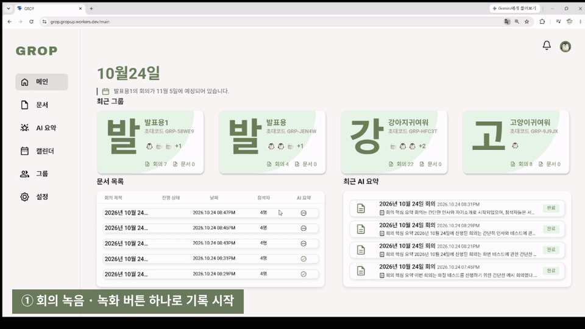
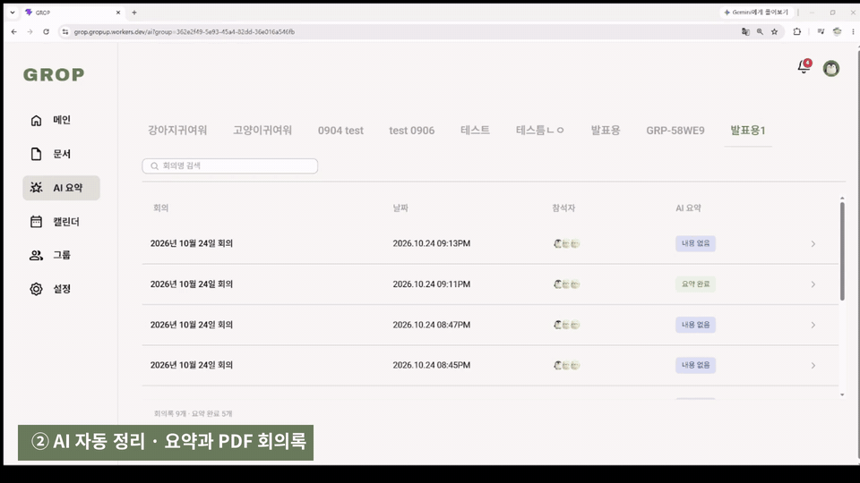
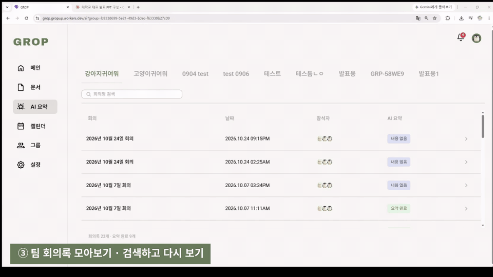
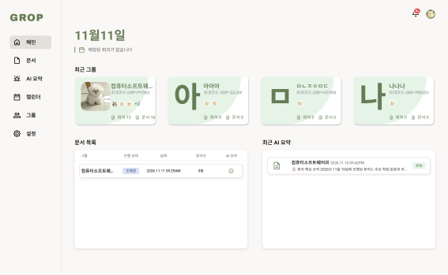
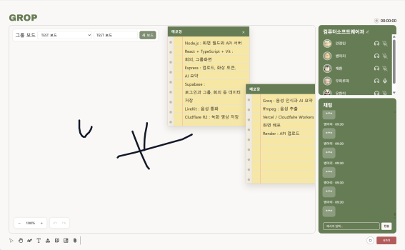
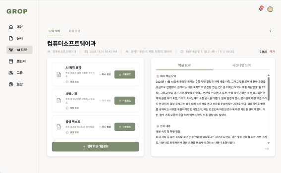
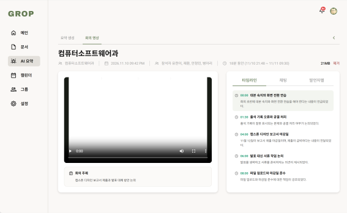
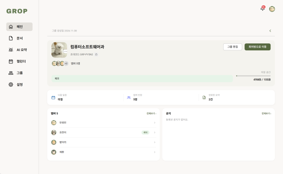
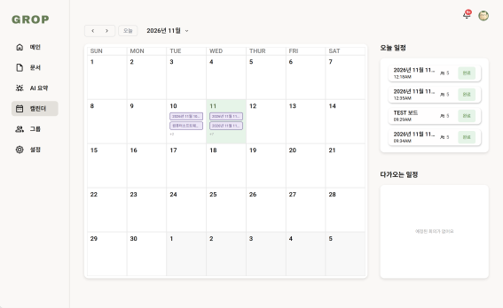
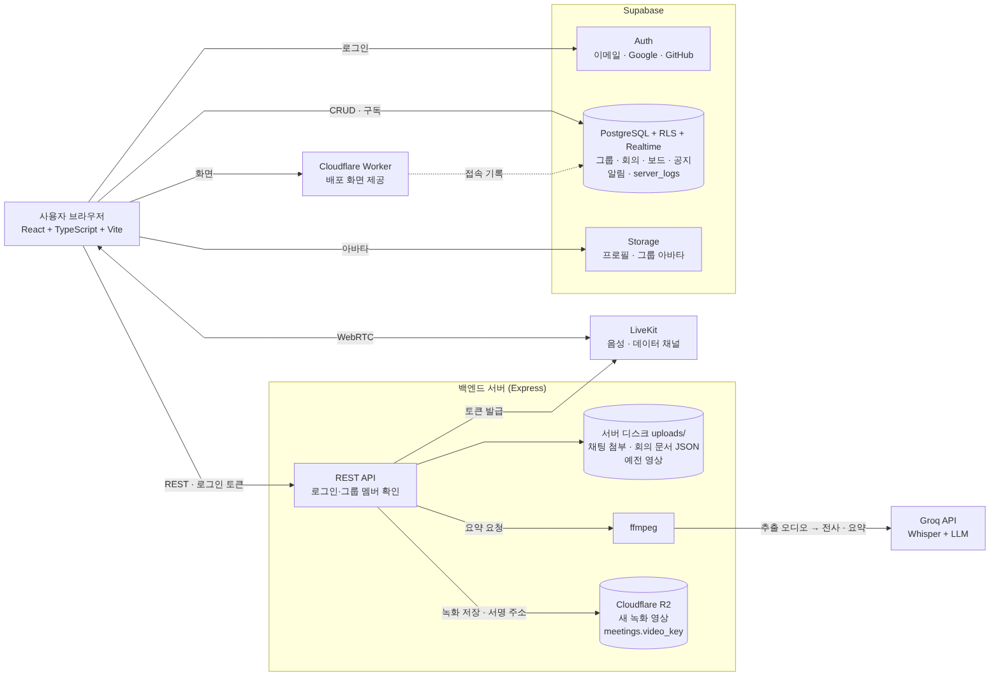

# GROP

**2026 유한대학교 컴퓨터소프트웨어공학과 졸업작품 프로젝트**

실시간 영상·음성 회의에 화이트보드·채팅·녹화·AI 서기(회의 요약)를 결합한 그룹 회의 웹 서비스입니다.

🏆 2026 경기도 미래성장페어 창업아이디어 경진대회 경기앵커상

> **Focus on Discussion, We Handle the Notes**
> 회의 중에는 논의에만 집중하고, 기록은 GROP이 녹화본에서 자동으로 정리합니다.

🌐 **서비스 바로가기: [grop.groupup.workers.dev](https://grop.groupup.workers.dev)**

### 🎬 시연

| ① 회의 녹음 | ② AI 자동 정리 | ③ 회의록 모아보기 |
|:--:|:--:|:--:|
|  |  |  |
| 녹화 버튼 하나로 기록 시작 | 요약·결정 사항 정리, PDF 회의록 | 팀 회의록을 검색하고 다시 보기 |

## 📋 목차

- [소개](#-소개)
- [성과](#-성과)
- [주요 기능](#-주요-기능)
- [실행 화면](#-실행-화면)
- [시스템 구조](#-시스템-구조)
- [기술 스택](#-기술-스택)
- [실행 방법](#-실행-방법)
- [프로젝트 문서](#-프로젝트-문서)
- [팀원](#-팀원)

## 💡 소개

회의를 하면서 동시에 기록하면 서기를 맡은 사람은 논의에 참여하기 어렵고, 손으로 쓴 회의록은 빠지는 내용이 많으며 나중에 찾아보기도 어렵습니다. GROP은 **음성 회의·화이트보드·채팅을 한 화면에서 제공**하고, 회의가 끝나면 **녹화본을 AI가 전사·요약해 회의록 초안**을 만들어 줍니다. 회의록은 문서·캘린더와 함께 그룹 단위로 보관되어, 새로 합류한 팀원도 날짜별 회의록과 타임랩스로 논의 과정을 따라잡을 수 있습니다.

- 유형: 캡스톤디자인 산학연계 프로젝트 (참여기업: 지스인포넷(주))
- 기간·인원: 9개월, 4인

### 다른 회의 도구와의 차이

Zoom 같은 도구는 AI 요약을 **회의 1건 단위**로 따로 저장합니다. GROP은 회의를 **팀(그룹) 단위로 쌓아서**, 지난 회의와 결정 사항을 한곳에서 찾아볼 수 있습니다.

## 🏆 성과

- **2026 경기앵커 GAIA-Festa 창업아이디어 경진대회 본선 진출 · 경기앵커상** ([본선 발표 자료](docs/presentation/GROP_본선발표.pdf))
- 실제 배포 완료 (프론트엔드 Cloudflare Worker, 백엔드 Render)
- 회의방 동시 접속 80명 테스트 (팀 자체 테스트, 2026.10)
- AI 엔진을 환경변수만으로 교체할 수 있게 설계 (현재 Groq, 대안 OpenAI·자체 서버)

## ✨ 주요 기능

### 🎙 회의방
- LiveKit 기반 실시간 음성 회의, 마이크 제어, 참여자 패널
- 같은 보드에서 함께 그리는 실시간 화이트보드 (도구 8종, 새 보드/기존 보드 선택)
- 회의 중 채팅과 파일 공유
- 캔버스 화면과 참여자 음성을 합성한 회의 녹화

### 🤖 AI 서기
- 녹화 음성을 Groq Whisper로 전사
- LLM으로 핵심 요약, 챕터, 주제, 발언자, 결정 사항, 다음 할 일 생성
- 챕터를 누르면 해당 시점으로 영상 이동
- 요약 초안을 직접 수정·저장·다운로드

### 🗂 기록 관리
- 회의록과 첨부 파일을 모은 문서함 (그룹별·내 문서, 검색, PDF 내보내기)
- 화이트보드 그리기 과정을 다시 보는 타임랩스 (재생 속도, 공백 압축, 구간 저장)
- 반복·알림을 지원하는 캘린더

### 👥 그룹
- 초대 코드·초대 링크로 가입 (로그인 후 원래 경로로 복귀)
- 리더/멤버 권한, 공지(상단 고정), 그룹별 프로필
- 이메일·Google·GitHub 로그인

## 🖥 실행 화면

| 메인 | 회의방 |
|:--:|:--:|
|  |  |
| **AI 요약** | **AI 요약 – 영상·타임라인** |
|  |  |
| **그룹 상세** | **캘린더** |
|  |  |

전체 화면은 [docs/05-구현](docs/05-구현.md#54-실행-화면)에서 볼 수 있습니다.

## 🏗 시스템 구조



- 브라우저(React)는 Supabase(Auth·PostgreSQL·Realtime)와 직접 통신하고, 그룹 데이터는 RLS로 그 그룹 멤버만 접근합니다.
- 음성과 회의 중 데이터(획·채팅)는 LiveKit(WebRTC)으로 주고받습니다.
- 비밀키가 필요한 일(LiveKit 토큰, 녹화 저장, AI 요약)은 Express 서버가 처리합니다.
- 녹화는 Cloudflare R2에 저장하고, ffmpeg로 뽑은 음성을 Groq Whisper·LLM으로 요약합니다.
- 실시간 경로와 AI 처리 경로를 분리해, 요약이 오래 걸려도 회의 화면은 멈추지 않습니다.

## 🛠 기술 스택

| 구분 | 기술 |
|---|---|
| Frontend | React 19, TypeScript, Vite, React Router 7, CSS Modules |
| Realtime | LiveKit |
| Backend | Node.js, Express 5, Multer, ffmpeg |
| Database / Auth | Supabase (PostgreSQL, RLS, Realtime, Auth, Storage) |
| AI | Groq API (Whisper, LLM) |
| Infra | Cloudflare Worker, Cloudflare R2, Render |
| Tools | Git/GitHub, Figma, VS Code, Claude Code, Cursor |

## 🚀 실행 방법

```bash
# 의존성 설치
npm install
cd server && npm install && cd ..

# 프론트(Vite) + 백엔드(Express) 동시 실행
npm start
```

- Supabase·LiveKit·Groq·R2 키는 환경변수로 설정합니다 (저장소에 포함하지 않음).
- DB 스키마는 `supabase/` 폴더의 SQL을 번호 순서대로 실행합니다.
- 녹화 백업은 [docs/백업_가이드](docs/백업_가이드.md)를 참고하세요.

## 📚 프로젝트 문서

소프트웨어 개발 7단계에 따라 정리한 산출물입니다. → [docs/](docs/README.md)

| 단계 | 문서 |
|:--:|---|
| 1 | [문제정의](docs/01-문제정의.md) |
| 2 | [요구사항](docs/02-요구사항.md) |
| 3 | [설계](docs/03-설계.md) — 아키텍처, ERD, API 명세, 시퀀스, 화면 설계 |
| 4 | [구조생성](docs/04-구조생성.md) |
| 5 | [구현](docs/05-구현.md) |
| 6 | [테스트](docs/06-테스트.md) |
| 7 | [수정 및 문서화](docs/07-수정및문서화.md) |

## 👥 팀원

| 이름 | 역할 | 담당 |
|:--:|:--:|---|
| 김지민 | 팀장 | 서비스 기획·시스템 아키텍처 설계, DB 구축 및 백엔드 개발, 브랜치 통합·배포 |
| 이규빈 | 팀원 | DB 구축 및 백엔드 개발 |
| 김소연 | 팀원 | UI/UX 설계 및 디자인 (Figma) |
| 안정민 | 팀원 | UI/UX 구현 및 제작 |

지도교수: 김원일 교수 · 참여기업: 지스인포넷(주)
