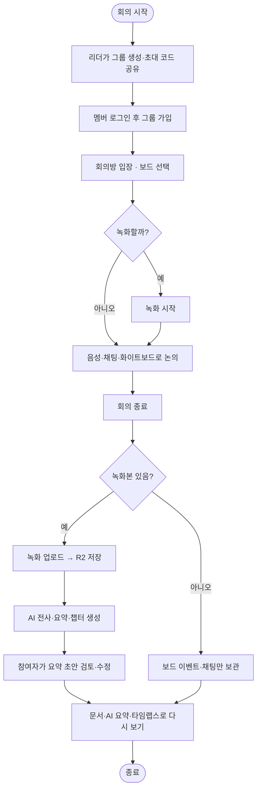

# 1단계. 문제 정의

[← 문서 목차](README.md)

## 1.1 문제 정의서

그룹 협업에서 **회의의 진행, 기록, 후속 관리가 서로 다른 도구에 흩어져 있어** 정보가 유실되고 회의록 작성에 시간이 낭비되는 것을 핵심 문제로 정의했습니다.

| 구분 | 현재 상황 | 결과 |
|---|---|---|
| 인력 낭비 | 회의 진행과 기록을 동시에 해야 해서 한 명이 서기를 맡음 | 서기의 회의 참여도 저하, 팀 전체 생산성 하락 |
| 기록 품질 | 사람이 빠른 회의 속도를 따라 적는 데 물리적 한계가 있음 | 누락·오기로 회의록의 정확도와 완성도 저하 |
| 관리·검색 | 수기 기록은 체계적으로 관리하기 어려움 | 검색·공유가 불편하고 중요 정보가 손실될 위험 |
| 온보딩 | 신규 인원이 과거 회의 맥락을 파악할 자료가 없음 | 프로젝트 합류 지연 |

### 근거 자료

| 지표 | 수치 | 출처 |
|---|---|---|
| 직장인 주당 평균 회의 | 3.7회 (회당 51분) | 대한상공회의소, 국내 기업의 회의문화 실태와 개선 해법(2017) |
| 명확한 결론 없이 끝나는 회의 | 55.2% | 대한상공회의소(2017) |
| 불필요한 회의로 버리는 주당 시간 | 2.8시간 | Asana, Anatomy of Work Global Index 2023 |
| AI 회의록 도구를 쓰는 사람 | 12% | ClickUp 회의 효율성 설문 |

회의는 많지만 결론 없이 끝나고, 기록은 흩어지고, 같은 논의가 반복되는 흐름이 팀 회의에서 되풀이됩니다.

### 과제 도출 과정

실제 기업 환경에서 겪는 비효율(인력 낭비, 핵심 인원의 참여도 저하, 회의록 품질과 지식 자산 관리 부실)을 분석하는 데서 출발했습니다. 수기 기록과 전담 서기의 한계를 넘기 위해 **AI 기반 음성 인식과 자동 요약**이 필요하다고 판단했고, 이를 통해 업무 생산성과 온보딩 효율을 높이는 방향으로 구체화했습니다. 진행 중 참여기업(지스인포넷)과 구글 캘린더, 디스코드식 실시간 음성통화 환경 지원을 논의했습니다.

### 기존 서비스와의 차이

| 항목 | Zoom Workplace (Pro) | GROP |
|---|---|---|
| AI 요약 단위 | 회의 1건 | 팀 누적 |
| 지난 회의 찾기 | 회의별로 따로 | 그룹 회의 목록·검색, 결정 사항 정리 |
| 무료로 되는 것 | 회의 + 내 컴퓨터 녹화 (40분마다 끊김) | 회의 + AI 요약 + 클라우드 녹화 |

다른 서비스는 회의마다 따로 저장해 흐름이 끊기지만, GROP은 회의를 팀 그룹 단위로 쌓아 지난 회의와 결정 사항을 한곳에서 이어 봅니다. (출처: Zoom 공식 요금 페이지, 2026.10)

## 1.2 목표

| 목표 | 내용 |
|---|---|
| 인력 효율성·몰입도 극대화 | 기록을 자동화해 모든 팀원이 논의와 의사결정에 몰입할 수 있게 함 |
| 회의록의 정확성·완성도 확보 | AI 음성 인식과 자동 텍스트 변환으로 정확한 회의록 산출 |
| 지식 자산의 체계적 아카이빙 | 회의 내용을 DB로 저장하고 검색·공유가 쉬운 구조로 관리 |
| 신규 인력 온보딩 효율화 | 과거 회의 아카이브로 신규 팀원의 맥락 파악 시간 단축 |

## 1.3 범위 정의서

| 구분 | 범위 안 (In Scope) | 범위 밖 (Out of Scope) |
|---|---|---|
| 회의 | 음성 회의방, 화이트보드, 채팅, 파일 공유, 녹화 | 대규모 웨비나, 외부 캘린더 양방향 동기화 |
| AI | 녹화 음성 → 전사 → 요약·챕터·주제·발언자 | 실시간 자막, 다국어 번역 |
| 관리 | 그룹 생성·초대, 리더·멤버 권한, 공지, 문서, 캘린더 | 결제, 조직 단위 관리자 콘솔 |
| 플랫폼 | 웹(PC 브라우저) 반응형 | 네이티브 모바일 앱 |

## 1.4 기대효과

| 기대효과 | 내용 |
|---|---|
| 회의 몰입도 향상 | 전담 서기가 필요 없어져 모든 팀원이 논의에 집중 |
| 실시간 협업 소통 강화 | 음성 통화·실시간 그림판·채팅을 한 곳에서 제공해 원격·하이브리드 환경의 소통 지연 최소화 |
| 기록의 정확성 확보 | 수기 기록의 누락·오기를 줄여 회의록 품질 향상 |
| 맥락 파악 기간 단축 | 날짜별 회의록·타임스탬프·타임랩스로 과거 의사결정 과정을 빠르게 파악 |
| 조기 전력화 | 온보딩 시간 단축으로 신규 팀원의 실제 합류 시점을 앞당김 |

## 1.5 회의 업무 흐름 (Activity)

