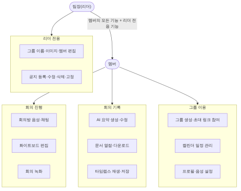

# 2단계. 요구사항

[← 문서 목차](README.md)

## 2.1 대표 사용자 시나리오 (사용자 스토리)

1. 리더(진행자)가 그룹을 만들고 초대 코드를 공유한다.
2. 참여자가 로그인한 뒤 원래 초대 경로로 돌아와 그룹에 가입한다.
3. 회의방에서 같은 보드를 선택하고 음성·채팅·그리기로 논의한다.
4. 참여자가 녹화를 종료하면 녹화본이 저장되고 회의록이 생성된다.
5. 참여자가 AI 요약 초안을 원본과 대조해 수정한다.
6. 신규 참여자가 날짜별 회의록과 타임랩스로 논의 과정을 확인한다.

## 2.2 기능 요구사항 (MoSCoW)

| 우선순위 | 기능 요구사항 | 비고 |
|:--:|---|---|
| Must | 이메일·소셜 로그인(Google/GitHub), 프로필 설정 | Supabase Auth |
| Must | 그룹 생성·초대 코드 참여, 리더/멤버 권한 구분 | 리더 = 그룹 첫 번째 멤버(생성자) |
| Must | 회의방: 음성, 화이트보드, 채팅 | LiveKit, 캔버스 이벤트 로그 |
| Must | 회의 녹화 업로드 및 AI 요약(전사·요약·챕터) | Express + Groq |
| Should | 문서 탭(회의 문서·첨부 파일), 공지 고정 | `meetings.attachments`, `notices.is_pinned` |
| Should | 캘린더 일정(반복·알림), 메인의 예정된 회의 | 현재 일정은 브라우저 저장 |
| Should | 캔버스 타임랩스(그리기 과정 재생·저장) | `board_events` 재생 |
| Could | 그룹별 프로필(닉네임·아바타), 음성 설정, 알림 | `group_profiles` |
| Won't | 네이티브 앱, 실시간 번역 자막 | 이번 범위 제외 |

## 2.3 개발 단계별 범위 (P0 / P1 / P2)

| 단계 | 포함 기능 | 완료 판단 |
|---|---|---|
| P0 핵심 시연 | 인증·프로필·그룹·권한, 음성·채팅·보드 선택과 협업, 녹화 저장, AI 요약 생성·편집, 회의록 조회, 기본 타임랩스 | 그룹 참여부터 저장된 회의 기록 확인까지 연속 시연 가능 |
| P1 사용성 확장 | 문서 목록·PDF 출력, 시간대별 요약과 챕터, 일정 등록·알림, 음성 설정, 검색, 타임랩스 카테고리·공백 압축 | 실제 기록을 다시 찾고 재사용하는 흐름 완성 |
| P2 범위 확인 후 | 카메라 화상, 일반 화면 공유, 발언자별 전사, 고급 문서 편집, 외부 공유, 다양한 파일 첨부 | 추가 설계와 기술 검증 후 채택 |

P2 기능은 삭제한 것이 아니라 핵심 흐름이 안정된 뒤로 미룬 것입니다.

## 2.4 비기능 요구사항

| 항목 | 요구사항 |
|---|---|
| 보안 | 그룹 데이터는 그 그룹 멤버만 접근(RLS). LiveKit·Groq·R2 비밀키는 서버 환경변수에만 보관 |
| 안정성 | 저장 성공 전에는 기존 상태 유지. AI 실패가 회의 원본과 기존 요약을 지우지 않음 |
| 성능 | AI 처리가 느려도 회의 화면이 멈추지 않도록 실시간 경로와 기록 처리 경로 분리 |
| 화면 대응 | 1440×900, 1920×1080 및 더 좁은 창에서 전체 화면 스크롤 없이 동작 |
| 유지보수 | AI 모델명은 환경변수(`GROQ_MODEL`, `GROQ_TRANSCRIBE_MODEL`)로 교체 가능 |

## 2.5 액터별 유스케이스

| 액터 | 주요 유스케이스 |
|---|---|
| 멤버 | 로그인 / 초대 코드로 그룹 참여 / 회의방 입장·화이트보드·채팅 / 회의록·AI 요약 열람 / 문서·캘린더 조회 / 그룹 프로필 수정 |
| 리더 | 멤버 기능 전체 + 그룹 정보·설정 수정 / 공지 작성·고정 / 멤버 관리 / 회의 생성 / 그룹 삭제·탈퇴 처리 |
| 시스템(AI) | 녹화 수신 → 오디오 추출 → 음성 인식 → 요약·챕터·주제·발언자 생성 → 저장 |

## 2.6 평가 지표 (검수 목표)

| 지표 | 측정 방법 | 검수 목표 |
|---|---|---|
| 핵심 흐름 완주 | 가입 또는 로그인부터 회의록 열람까지 수행 | 준비된 시나리오 10회 모두 성공 |
| 협업 정합성 | 동시 편집 후 두 클라이언트와 새로고침 결과 비교 | 저장된 객체 상태와 재접속 결과 일치 |
| 요약 품질 | 테스트 회의의 핵심 결정 10개를 사람이 대조 | 8개 이상 반영, 근거 없는 결정사항 0개 |
| 권한 차단 | 타 그룹 ID와 파일 주소로 접근 시도 | 비인가 조회·수정·다운로드 모두 차단 |
| 화면 대응 | 1440×900, 1920×1080 및 더 좁은 창 | 전체 화면 스크롤 없음, 패널 높이 유연 조정 |

## 2.7 용어 사전

| 용어 | 뜻 |
|---|---|
| 그룹 | 회의·공지·문서를 공유하는 팀 단위. 초대 코드로 가입 |
| 리더 | 그룹의 첫 번째 멤버(보통 생성자). 그룹 설정·공지 관리 권한 |
| 보드 | 화이트보드 한 장. 개인 보드(`group_id` 없음)와 그룹 보드가 있음 |
| 보드 이벤트 | 그리기 동작 하나하나의 기록(`board_events`, 순번 `seq`). 타임랩스·복구의 기반 |
| 타임랩스 | 보드 이벤트를 순서대로 다시 재생하는 기능 |
| AI 서기 | 녹화 음성을 전사·요약해 회의록 초안을 만드는 기능 |
| 챕터 | 전사문 타임스탬프 기준으로 나눈 회의 구간. 누르면 영상이 해당 시점으로 이동 |
| 짧은 주소 | 영상·첨부를 열 때 쓰는 서명된 임시 URL |
