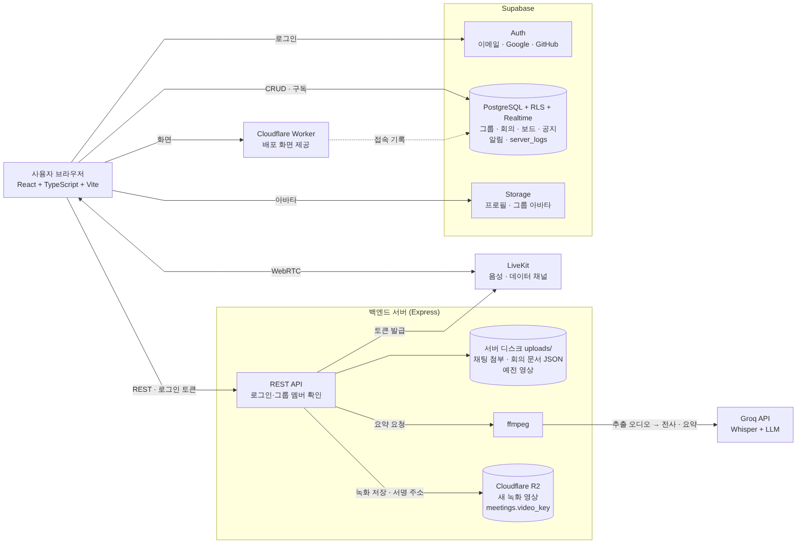
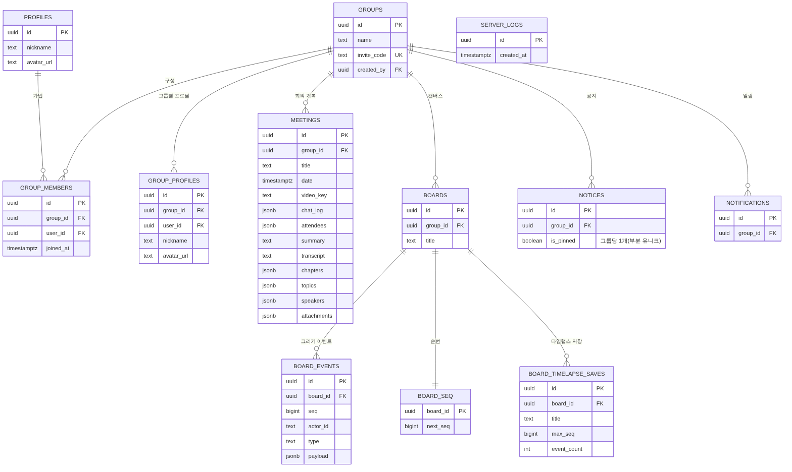
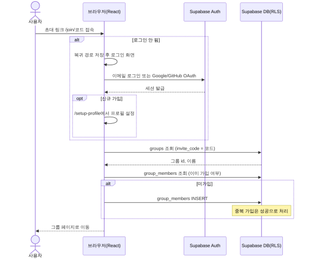
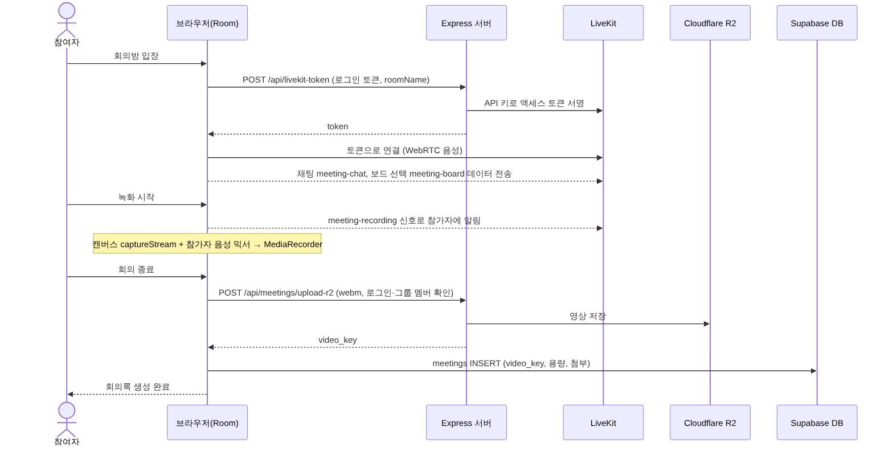
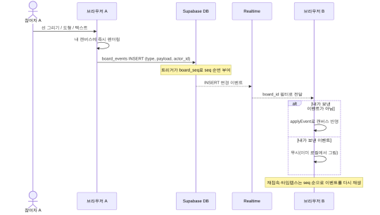
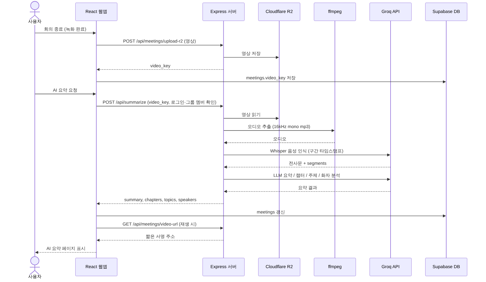
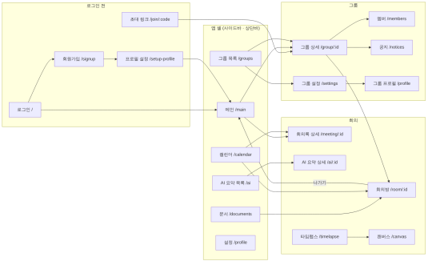

# 3단계. 설계

[← 문서 목차](README.md)

## 3.1 시스템 아키텍처

- **브라우저(React)** 는 Supabase와 직접 통신합니다. 인증은 이메일·Google·GitHub이고, 그룹·회의·보드·알림은 PostgreSQL(RLS)에 있으며, 저장된 보드 변경과 알림은 Realtime으로 받습니다.
- **회의 중 데이터**(획·채팅·파일 알림)는 LiveKit 데이터 채널로 주고받습니다. 음성은 Express가 발급한 토큰으로 브라우저와 LiveKit이 WebRTC로 직접 연결됩니다.
- **비밀키나 파일이 필요한 일은 Express**가 처리합니다. LiveKit 토큰, 진행 중인 방 목록, 참가자 내보내기, 채팅 첨부, 회의 문서 목록, 영상·첨부용 짧은 주소, AI 요약이 여기에 해당합니다.
- **새 녹화**는 브라우저 → Express → Cloudflare R2 순서로 저장합니다. `meetings`에는 파일 대신 `video_key`와 용량을 기록합니다.
- **AI 요약**은 Express가 ffmpeg로 음성을 뽑은 뒤 Groq의 Whisper(전사)와 LLM(요약)을 호출합니다.
- **배포된 화면**은 Cloudflare Worker가 제공하고, 접속 기록은 Supabase `server_logs`에 남깁니다. Supabase Storage는 프로필·그룹 아바타에만 씁니다.

## 3.2 데이터베이스 설계 (ERD)

그룹에 속한 회의·공지·멤버 데이터는 Row Level Security로 그 그룹의 멤버만 읽고 쓰게 합니다. `group_id`가 비어 있는 개인 보드는 로그인한 사용자가 볼 수 있게 두어, 예전에 만든 개인 캔버스가 사라지지 않게 했습니다. 회의 요약 결과(`chapters`, `topics`, `speakers`, `attachments`), 채팅 기록(`chat_log`), 참석자(`attendees`)는 JSONB로 저장합니다.

| 테이블 | 설명 |
|---|---|
| `profiles` / `group_profiles` | 전체 프로필, 그룹별 닉네임·아바타 |
| `groups` / `group_members` | 그룹(초대 코드, 생성자)과 구성원 |
| `meetings` | 회의 기록: 일시, 녹화(`video_key`·용량), 전사문, 요약, 챕터, 주제, 발언자, 첨부 |
| `boards` / `board_events` / `board_seq` | 캔버스 보드와 그리기 이벤트 로그(순번 자동 증가) |
| `board_timelapse_saves` | 저장한 타임랩스 구간(`max_seq`, 이벤트 수) |
| `notices` | 그룹 공지(그룹당 고정 공지 1개, 부분 유니크 인덱스로 보장) |
| `notifications` | 그룹 알림 |
| `server_logs` | 서버·배포 화면의 접속 기록 |

스키마 SQL은 [`supabase/`](../supabase) 폴더에 번호 순서(01~08, 12~20)대로 있습니다.

## 3.3 API 명세 (Express 서버)

| 메서드 | 경로 | 설명 |
|:--:|---|---|
| GET | `/health` | 서버 상태 확인 |
| GET / POST | `/api/oauth-origin` | OAuth 로그인 복귀 주소 조회·저장 |
| POST | `/api/livekit-token` | 회의방 입장용 LiveKit 액세스 토큰 발급 |
| GET | `/api/live-rooms` | 호출자가 속한 그룹의 진행 중 방만 반환 |
| POST | `/api/live-room-meeting` | 진행 중 방에 회의 행 연결 |
| POST | `/api/livekit-remove-participant` | 그룹 멤버가 참가자 내보내기 |
| POST | `/api/meetings/upload-r2` | 새 녹화 수신 후 R2 저장 (로그인·그룹 멤버 확인) |
| GET | `/api/meetings/video-url` | R2 영상 재생용 짧은 주소 발급 |
| GET | `/api/media-url` | 디스크의 예전 영상·채팅 첨부용 짧은 주소 발급 |
| GET | `/api/meetings/storage` | 호출자가 속한 그룹의 영상 용량 조회 |
| DELETE | `/api/meetings/video` | 녹화 파일 삭제 |
| DELETE | `/api/meetings/record/:id` | 회의 녹화 기록 삭제 |
| POST | `/api/chat-files/upload` | 채팅 첨부 업로드 |
| GET | `/api/chat-files` | 그룹의 첨부 목록 |
| PATCH | `/api/chat-files/name` | 첨부 이름 변경 |
| DELETE | `/api/chat-files` | 첨부 삭제 |
| PUT / GET | `/api/meeting-docs/:meetingId` | 회의 문서 목록 저장·조회 |
| GET | `/api/meeting-docs` | 그룹의 회의 문서 목록 |
| POST | `/api/summarize` | 녹화 음성 전사 후 AI 요약·챕터·주제·발언자 생성 |

- `/videos`, `/files`는 서명된 주소가 있을 때만 파일을 내려줍니다.
- `POST /api/meetings/upload`, `POST /api/meetings/upload-url`은 예전 디스크 저장용으로 남아 있고, 새 녹화는 `upload-r2`를 씁니다.
- 로그인, 그룹, 회의 목록, 공지, 프로필은 프론트엔드가 Supabase 클라이언트로 직접 처리하며, RLS와 `is_group_member`, `get_group_members_with_profiles`, `ensure_group_creator_member` 함수가 접근을 통제합니다.

## 3.4 주요 흐름 (시퀀스 다이어그램)

### 가. 초대 링크 참여

로그인하지 않은 사용자가 초대 링크로 들어오면 복귀 경로를 저장하고, 로그인(신규 가입이면 프로필 설정 포함)을 거친 뒤 원래 경로로 돌아와 그룹에 가입합니다. 이미 가입했다면 중복 생성 없이 그룹으로 이동합니다.

### 나. 회의방 입장과 녹화

입장할 때 서버가 LiveKit API 비밀키로 토큰을 서명해 주므로 비밀키가 브라우저에 노출되지 않습니다. 녹화는 녹화를 시작한 참여자의 브라우저에서 캔버스와 음성을 합성해 만들고, 종료하면 서버에 업로드한 뒤 회의록 행을 만듭니다.

### 다. 화이트보드 실시간 동기화

그린 내용을 내 화면에 먼저 반영한 뒤 LiveKit 데이터 채널로 다른 참여자에게 보냅니다. 같은 내용을 `board_events`에 순번(`seq`)과 함께 저장하고, Supabase Realtime으로 늦게 들어온 참여자와 다른 화면이 따라오게 합니다. 타임랩스와 재접속 복구는 이 이벤트 기록을 순서대로 다시 그립니다.

### 라. 녹화에서 AI 요약까지

영상 전체가 아니라 오디오만 16kHz 모노 mp3로 추출해 Whisper의 25MB 한도 안에서 처리합니다. 용량을 넘으면 회의를 나눠 녹화하도록 안내합니다.

## 3.5 권한 설계

역할은 리더와 멤버 두 종류입니다. 화면에서는 그룹의 첫 번째 멤버(가입 순서 기준)를 리더로 판정하고, DB에서는 RLS 정책으로 그룹 구성원만 그 그룹의 데이터에 접근하게 합니다.

| 동작 | 리더 | 멤버 | 비회원·타 그룹 |
|---|:--:|:--:|:--:|
| 그룹 정보·회의록·공지 조회 | 가능 | 가능 | 차단 |
| 그룹 이름·대표 이미지·멤버 편집 | 가능 | 읽기 전용 | 차단 |
| 공지 등록·수정·삭제·고정 | 가능 | 조회만 | 차단 |
| 회의방 참여, 그룹 보드 편집 | 가능 | 가능 | 차단 |
| AI 요약 생성·수정, 문서 다운로드 | 가능 | 가능 | 차단 |
| 문서(회의록) 수정 | 작성자만 | 작성자만 | 차단 |
| 그룹 탈퇴 | 가능(리더 위임 또는 그룹 삭제) | 가능 | – |

공지 작성 권한은 화면과 서버 호출 양쪽에서 확인하고, 그룹 정보 수정은 RLS의 `groups_update_creator` 정책으로 한 번 더 제한합니다.

## 3.6 입력·오류 처리 정책

- **인증**: 이메일·비밀번호 가입/로그인, 비밀번호 재설정, Google·GitHub 소셜 로그인. 입력 오류는 한글로 안내합니다.
- **프로필**: 닉네임 최대 12자, 공백만 입력하면 저장 불가. 그룹 프로필이 없으면 기본 프로필을 씁니다.
- **초대 참여**: 로그인 후 원래 초대 경로로 복귀, 잘못된 코드는 안내, 이미 가입했으면 중복 없이 이동.
- **접근 제한**: 없는 경로(404)와 권한 없는 자료(접근 제한)를 구분합니다.
- **저장·AI 실패**: 저장 성공 전에는 기존 상태 유지, AI 실패가 원본과 기존 요약을 지우지 않습니다.

## 3.7 화면 설계

### 공통 레이아웃

- **AppShell**: 로그인 이후 대부분의 화면을 감싸는 틀. 왼쪽 사이드바에 메인·문서·AI 요약·캘린더·그룹·설정 6개 메뉴, 상단바에 알림 버튼과 프로필 아이콘.
- **AppShell이 없는 화면**: 로그인, 회원가입, 프로필 설정, 초대 링크, 404, 회의방(자체 상단바).
- **가로 규칙**: 1440px 이상은 비율대로 확대, 그보다 좁으면 중앙 영역만 줄이고 사이드바는 고정, 952px 미만은 가로 스크롤 허용.

### 화면 이동도

### 화면 목록

| 번호 | 화면 | 경로 | 구성·기능 |
|:--:|---|---|---|
| S-01 | 로그인 | `/` | 서비스 소개, 이메일 로그인, Google·GitHub 로그인, 비밀번호 찾기 |
| S-02 | 회원가입 | `/signup` | 이름·이메일·비밀번호·소속(선택), 약관 안내, 소셜 가입 |
| S-03 | 메인 | `/main` | 최근 그룹 카드, 그룹 만들기, 예정된 회의, 문서 목록, 최근 AI 요약 |
| S-04 | 그룹 목록 | `/groups` | 전체 그룹 카드, 정렬, 그룹 추가 |
| S-05 | 그룹 상세 | `/group/:id` | 그룹 정보, 초대 코드 복사, 다음 일정, 완료된 요약, 공지 미리보기, 회의방 입장 |
| S-06 | 멤버 목록 | `/group/:id/members` | 이름·역할·가입일, 그룹 나가기 |
| S-07 | 공지 목록 | `/group/:id/notices` | 제목·작성자·작성일, 고정 표시, 새 공지(리더) |
| S-08 | 그룹 설정 | `/group/:id/settings` | 대표 이미지, 이름 변경, 그룹 메모, 멤버 목록 |
| S-09 | 그룹 프로필 | `/group/:groupId/profile` | 그룹에서 쓸 닉네임·아바타 |
| S-10 | 설정 | `/profile` | 프로필 관리, 비밀번호 변경, 음성 설정 |
| S-11 | 회의방 | `/room/:id` | 음성 회의, 화이트보드, 채팅·참여자 패널 |
| S-12 | AI 요약 목록 | `/ai` | 회의명 검색, 회의·날짜·참석자·요약 상태 |
| S-13 | AI 요약 상세 | `/ai/:meetingId` | 핵심 요약·타임라인·영상 탭, 수정·저장·다운로드, 챕터 클릭 시 영상 이동 |
| S-14 | 문서 | `/documents` | 전체·그룹별·내 문서 탭, 검색, 첨부 보기, 수정·내보내기·삭제 |
| S-15 | 캘린더 | `/calendar` | 월간 달력, 오늘·다가오는 일정, 등록·수정(반복·알림) |
| S-16 | 404 | `*` | 등록되지 않은 경로 안내 |

이 밖에 `/setup-profile`, `/join/:code`, `/create`, `/canvas`, `/group/:id/canvas`, `/group/:id/meeting/:meetingId`, `/timelapse`, `/server-logs` 경로가 있어 라우트는 모두 24개입니다.

### 팝업·패널 목록

| 번호 | 이름 | 열리는 곳 | 구성·기능 |
|:--:|---|---|---|
| P-01 | 그룹 추가 | 메인, 그룹 목록 | 새 그룹 만들기 또는 초대 코드로 참가 |
| P-02 | 그룹 편집 | 그룹 상세 | 이름·메모, 멤버 목록, 내 그룹 프로필. 리더만 수정 |
| P-03 | 그룹 프로필 편집 | 그룹 편집 창 | 이 그룹에서 쓸 닉네임·아바타 |
| P-04 | 그룹 나가기 확인 | 멤버 목록 | 나가기 확인 → (리더) 새 리더 지정 또는 그룹 삭제 |
| P-05 | 내 프로필 수정 | 상단바 | 화면 이동 없이 닉네임·아바타 수정 |
| P-06 | 알림 패널 | 상단바 | 알림 목록 (현재 화면만 구현, DB 미연결) |
| P-07 | 공지 등록·수정 | 공지 목록 | 제목·내용, 상단 고정 |
| P-08 | 공지 상세 | 공지 목록 | 내용, 수정·삭제(리더) |
| P-09 | 첨부 파일 목록 | 문서 | 첨부 목록과 내려받기 |
| P-10 | 문서 더보기 메뉴 | 문서 행 | 수정, 내보내기, 삭제 |
| P-11 | 일정 등록·수정 | 캘린더 | 제목, 그룹, 시작·종료, 반복, 알림 시간 |
| P-12 | 일정 상세 | 캘린더 | 일정 정보, 이전·다음 이동, 회의방 입장 |
| P-13 | 날짜 우클릭 메뉴 | 캘린더 | 해당 날짜에 일정 추가 |
| P-14 | 보드 선택 | 회의방·캔버스 진입 | 새 보드 생성 또는 기존 보드 불러오기 |
| P-15 | 타임랩스 패널 | 타임랩스 | 보드 선택, 재생 속도, 공백 압축, 타임라인, 저장 |
| P-16 | 음성 설정 패널 | 설정 | 마이크·스피커 선택과 음량, 입력 레벨 표시 |

화면 디자인은 Figma로 진행했습니다. 화면별 실제 구현 캡처는 [05-구현](05-구현.md#53-실행-화면)에 있습니다.
