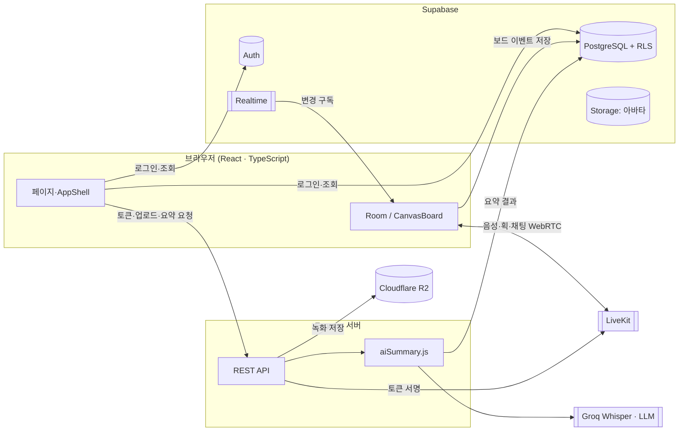
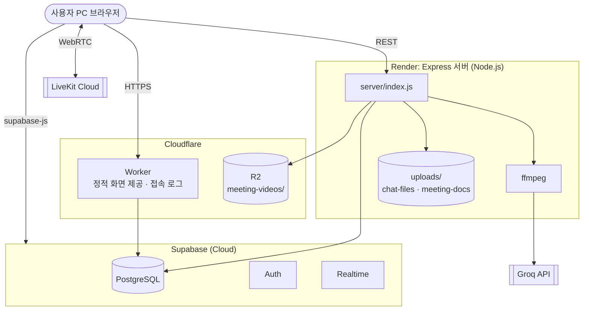

# 4단계. 구조 생성

[← 문서 목차](README.md)

## 4.1 기술 스택

| 구분 | 내용 |
|---|---|
| 프론트엔드 | React 19, TypeScript, Vite, React Router 7, CSS Modules |
| 실시간 음성·데이터 | LiveKit (`livekit-client`, `@livekit/components-react`) |
| 백엔드 | Node.js, Express 5, Multer(파일 업로드), ffmpeg(오디오 추출) |
| 데이터베이스·인증 | Supabase (PostgreSQL, Auth, Realtime, Storage, RLS) |
| AI | Groq API — Whisper(음성 인식), LLM(요약) |
| 파일 저장 | Cloudflare R2 (회의 녹화) |
| 배포 | 프론트엔드: Cloudflare Worker / 백엔드: Render(Express) |
| 문서 출력 | jsPDF, html2canvas, pdf.js |
| 개발 도구 | VS Code, Git/GitHub, Figma, ESLint |
| 언어 | TypeScript, JavaScript(Node.js), SQL(PostgreSQL), CSS |

## 4.2 구성 요소별 역할 (Component)

| 구성 요소 | 담당 역할 | 설계 기준 |
|---|---|---|
| React · TypeScript | 화면, 라우팅, 보드·폼·미디어 상태 | 공통 UI와 기능 모듈 분리 |
| Supabase Auth | 가입·세션·소셜 로그인 | 이메일 인증, 복귀 경로, 로그아웃 |
| Supabase DB | 그룹·멤버·보드·회의·요약 메타데이터 | 그룹 단위 접근 규칙(RLS), 관계·고유 제약 |
| Supabase Storage | 프로필·그룹 아바타 | 아바타만 저장. 첨부와 녹화는 두지 않음 |
| Supabase Realtime | 저장된 보드 변경과 알림 전파 | 회의 중 획의 즉시 전달은 LiveKit이 담당 |
| LiveKit | 실시간 음성, 참여자 상태, 채팅·획·파일 알림 | 서버가 그룹 멤버에게만 토큰 발급 |
| Express | 토큰, 녹화의 R2 저장, 첨부, 문서 목록, 짧은 주소, AI 요약 | API 키는 서버에만 보관 |
| Groq | 음성 전사(Whisper)와 요약(LLM) | 모델명은 환경변수로 교체 가능 |
| Cloudflare R2 | 새 회의 녹화 파일 | 브라우저가 직접 올리지 않고 Express가 저장 |
| Cloudflare Worker | 배포된 화면 제공, 접속 로그 기록 | 사용량 숫자는 DB 기록으로 계산 |

실시간 경로(브라우저↔LiveKit)와 기록 처리 경로(Express→R2→Groq→DB)를 분리해서, AI 처리가 느려도 회의 화면이 멈추지 않게 했습니다.

## 4.3 배포 구조 (Deployment)

녹화 백업은 [`scripts/backup-r2.sh`](../scripts/backup-r2.sh)(Windows는 `backup-r2.ps1`)로 R2 내용을 백업 PC에 내려받습니다. 자세한 방법은 [백업_가이드](백업_가이드.md)에 있습니다.

## 4.4 폴더 구조

| 경로 | 역할 |
|---|---|
| `src/pages` | 화면 단위 컴포넌트 (Main, Group, Room, AiSummary, Calendar 등) |
| `src/components` | 공용 컴포넌트 (AppShell, 회의 채팅 패널, 모달, 타임랩스 패널 등) |
| `src/hooks` | `useAppShellScale` 등 레이아웃·화면 비율 훅 |
| `src/utils`, `src/services` | 회의 녹화·동기화, 채팅, 일정, 음성 설정 등 |
| `src/styles`, `grop/css` | 전역 스타일, 페이지별 CSS (CSS Modules 병행) |
| `server` | Express 서버 (LiveKit 토큰, 업로드, AI 요약, OAuth 보조, 요청 로그) |
| `worker` | Cloudflare Worker (배포 화면 제공) |
| `supabase` | DB 스키마·RLS·함수 SQL (번호 순서대로 실행) |
| `scripts` | R2 백업, 예전 영상의 R2 이전 스크립트 |

## 4.5 코딩 규칙

- 컴포넌트는 함수형 + Hooks로 작성하고, TypeScript 타입을 명시하며 `any`를 최소화합니다.
- 컴포넌트·함수 상단에 역할 주석을 남기고, 복잡한 분기에는 "왜 그렇게 처리했는지"를 주석으로 설명합니다.
- 스타일은 페이지별 CSS Modules가 기본이며, 화면 크기에 따른 간격은 `clamp()`와 CSS 변수로 조절합니다.
- 새 라이브러리를 임의로 들이지 않고 기존 컴포넌트·훅·유틸을 먼저 재사용합니다.
- AI 도구(Claude Code, Cursor)를 함께 쓰며, 저장소 루트의 [`CLAUDE.md`](../CLAUDE.md)에 위 규칙을 적어 두어 AI도 같은 규칙을 따르게 했습니다.

## 4.6 브랜치 전략

- 기능 브랜치(`feature/…`)에서 작업한 뒤 통합 브랜치로 병합하고, 최종본을 `main`에 병합합니다.
- 팀장이 UI 담당·백엔드 담당 작업의 병합과 통합을 관리했습니다.
- 클라우드(R2·Worker) 전환 작업은 `CLOUD` 브랜치에서 진행한 뒤 `main`에 병합합니다.
- 커밋 메시지는 `feat:`, `fix:`, `docs:` 접두어를 씁니다.
