# 5단계. 구현

[← 문서 목차](README.md)

## 5.1 개발 결과 요약

GROP은 회의방에서 음성·채팅·화이트보드로 논의하고, 회의가 끝나면 녹화본에서 AI가 회의록을 만들어 문서·일정과 함께 관리하는 웹 서비스입니다. 로그인부터 그룹 생성, 회의, 요약, 문서 열람까지 하나의 흐름으로 시연할 수 있습니다.

| 항목 | 결과 |
|---|---|
| 구현 화면 | 라우트 24개 (로그인·가입, 메인, 그룹 목록·상세·설정·멤버·공지, 회의방, 캔버스, 타임랩스, AI 요약, 문서, 캘린더 등) |
| 소스 규모 | `src`의 TypeScript/React 약 2.8만 줄, Express 서버, Cloudflare Worker, Supabase SQL 스크립트 |
| 데이터베이스 | 그룹·멤버·프로필·회의·보드·이벤트·타임랩스·공지·알림·서버 로그. RLS와 RPC 포함 |
| 서버 API | Express REST 엔드포인트 23개 + 파일 전달용 `/videos`, `/files` |
| 개발 기간 | 9개월 (4인) |

## 5.2 기능별 구현 내용과 핵심 로직

### (1) 메인 대시보드
내가 속한 그룹과 예정된 회의를 한 화면에서 보여 주고, 사이드바로 문서·AI 요약·캘린더·그룹·설정으로 이동합니다. 그룹 생성과 초대 코드 참여도 여기서 바로 할 수 있습니다.

### (2) 회의방
LiveKit 룸에 입장해 음성으로 논의하고, 같은 보드에서 도구를 골라 함께 그립니다. 오른쪽 패널에 참여자와 채팅이 보이며, 창 너비가 1100px 이하가 되면 패널을 숨겨 화이트보드 공간을 확보합니다. 녹화는 캔버스와 UI를 합성하고 참여자 음성을 믹싱해 한 파일로 저장합니다.

### (3) 화이트보드 동기화
획은 LiveKit 데이터 채널로 먼저 전달하고, 모든 그리기 동작을 `board_events`에 순번(`seq`)과 함께 저장합니다. 늦게 입장한 참여자는 Supabase Realtime으로 따라옵니다. 이 기록이 타임랩스 재생과 새로고침 후 복구의 기반입니다.

### (4) AI 회의 요약 (`server/aiSummary.js`)
1. 녹화 영상에서 오디오만 추출합니다 (ffmpeg, 16kHz 모노 mp3 → Whisper 25MB 한도 대응).
2. Groq Whisper로 전사해 타임스탬프가 붙은 전사문을 만듭니다.
3. 전사문을 LLM에 넣어 핵심 요약, 챕터, 주제, 발언자, 결정 사항, 다음 할 일을 JSON으로 받습니다.
4. 챕터는 전사문의 실제 타임스탬프만 쓰도록 제한해, 근거 없는 시점이 생기지 않게 했습니다.
5. 모델명은 `GROQ_MODEL`, `GROQ_TRANSCRIBE_MODEL` 환경변수로 바꿀 수 있어, 모델이 폐기돼도 코드를 고치지 않아도 됩니다.

### (5) AI 요약 화면
핵심 요약·타임라인 탭과 영상 탭을 제공하고, 챕터를 누르면 해당 시점으로 영상이 이동합니다. 요약은 직접 수정·저장하고 다운로드할 수 있습니다.

### (6) 문서
회의록과 회의 중 올린 첨부 파일을 모아 그룹별·내가 올린 문서 탭으로 보여 주고, 검색과 다운로드를 지원합니다. 문서 수정은 작성자만 할 수 있습니다.

### (7) 캘린더
월간 달력에서 일정을 추가·수정·삭제하고 반복 규칙과 알림 시간을 지정합니다. 메인의 "예정된 회의"와 같은 계산 모듈을 공유합니다.

### (8) 그룹과 권한
그룹 상세에서 멤버·공지·회의 미리보기를 보고, 리더는 그룹 설정·공지를 관리합니다. 리더가 탈퇴할 때는 리더를 위임하거나 그룹을 삭제하도록 안내합니다.

### (9) 타임랩스
보드 이벤트를 순서대로 재생하며 재생 속도와 공백 압축을 조절하고, 원하는 구간에 이름을 붙여 저장하거나 삭제합니다.

### (10) 설정
프로필(닉네임 최대 12자, 아바타), 그룹별 프로필, 음성 설정(입출력 장치, 음량, 마이크 테스트)을 관리합니다.

### 주요 컴포넌트

| 컴포넌트 | 역할 |
|---|---|
| `AppShell` | 사이드바·상단바를 공통으로 제공하고 모든 페이지를 감싸는 레이아웃 |
| `useAppShellScale` | 1440px 기준으로 화면을 확대하고, 높이는 최소 높이까지만 줄여 전체 화면 스크롤이 생기지 않게 하는 훅 |
| `Room` / `CanvasBoard` | LiveKit 음성과 캔버스 렌더링, 이벤트 기록(타임랩스 데이터) |
| `MeetingChatPanel` | 회의방 채팅. 창 너비 1100px 이하에서는 숨김 |

## 5.3 회의 기록 상태 (State)

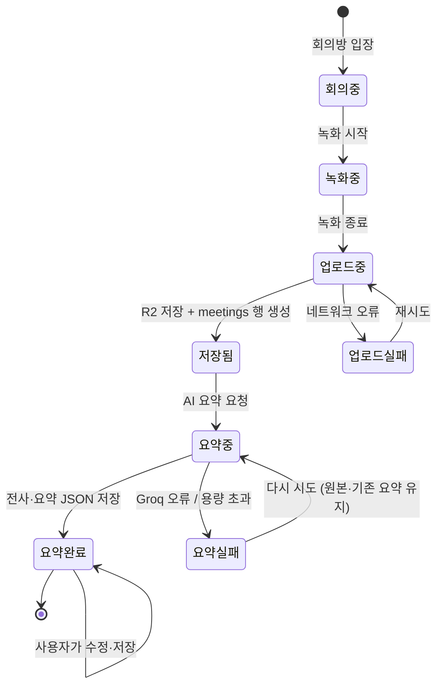

## 5.4 실행 화면

### 시연

| ① 회의 녹음 | ② AI 자동 정리 | ③ 회의록 모아보기 |
|:--:|:--:|:--:|
| 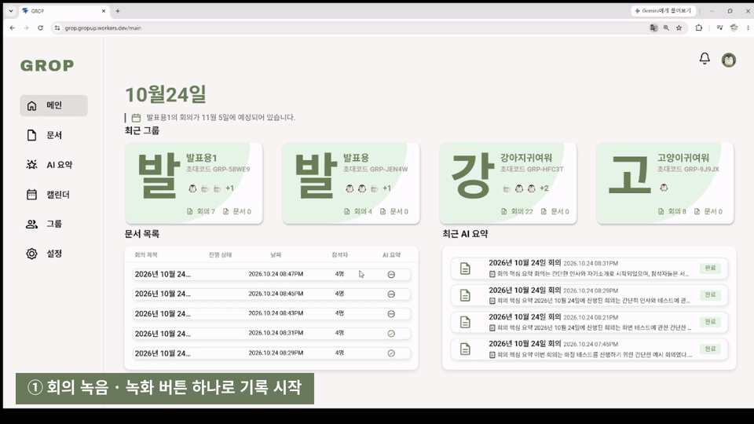 | 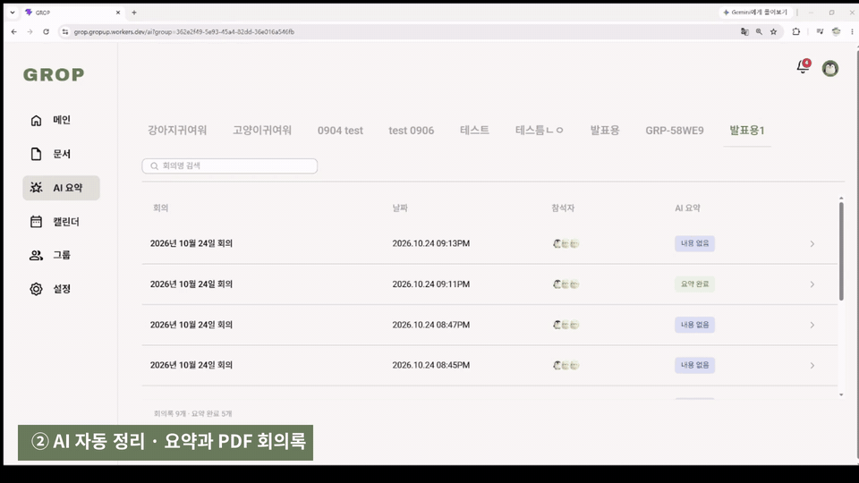 | 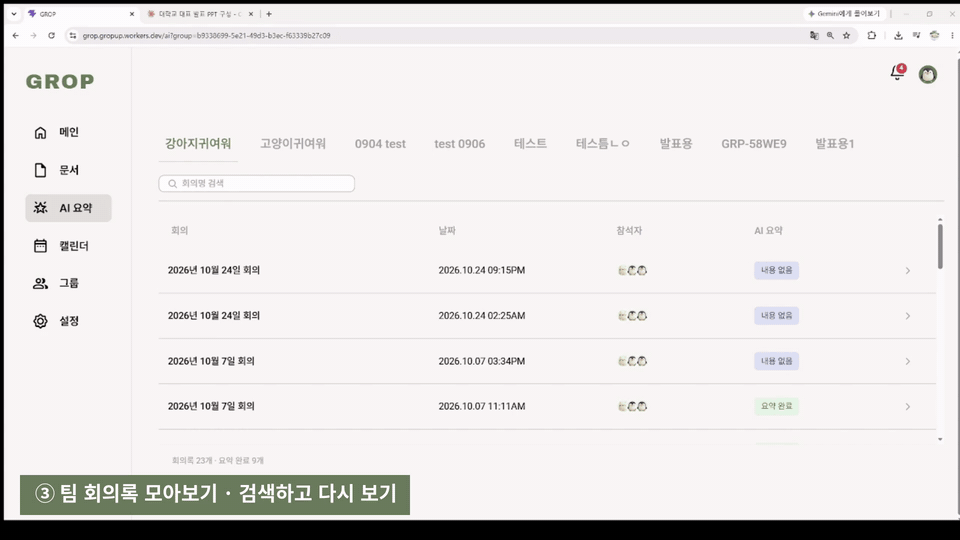 |

### 화면별 캡처

| 로그인 | 회원가입 |
|:--:|:--:|
| 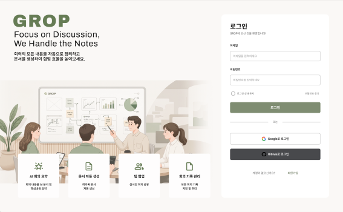 | 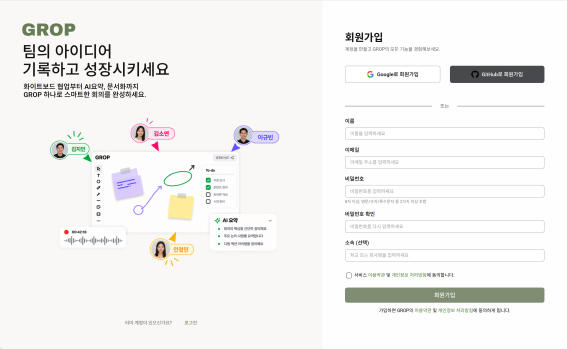 |
| **메인** | **그룹 목록** |
| 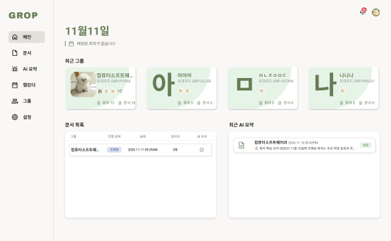 | 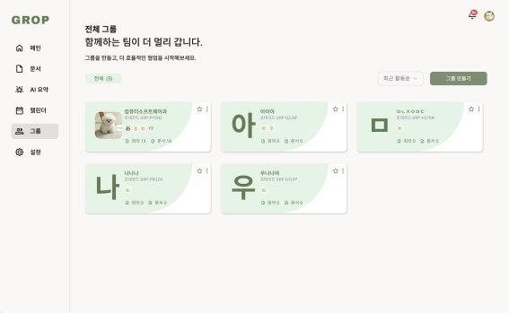 |
| **그룹 상세** | **멤버 목록** |
| 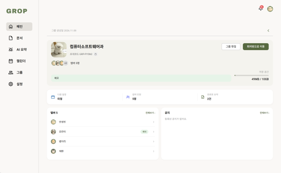 | 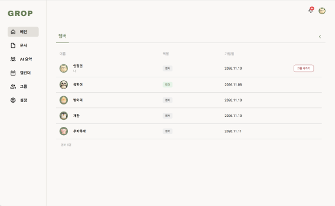 |
| **공지 목록** | **그룹 편집** |
| 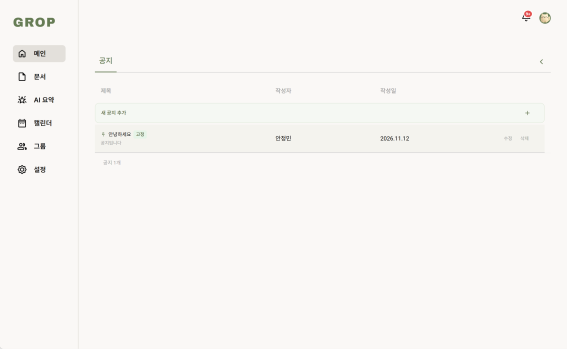 | 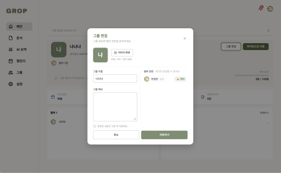 |
| **그룹 프로필** | **설정(프로필)** |
| 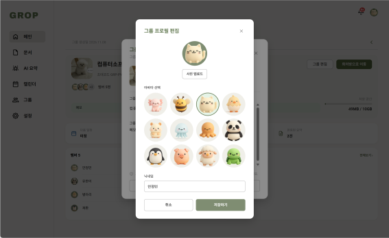 | 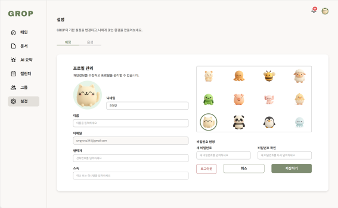 |
| **음성 설정** | **회의방** |
| 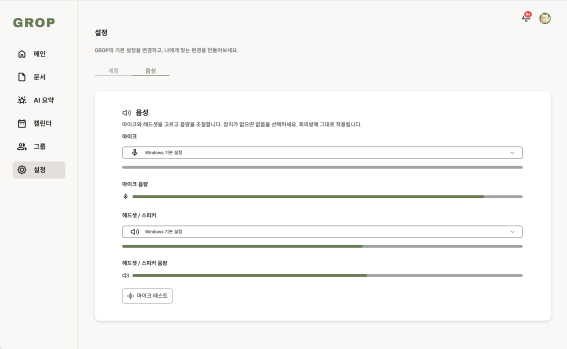 | 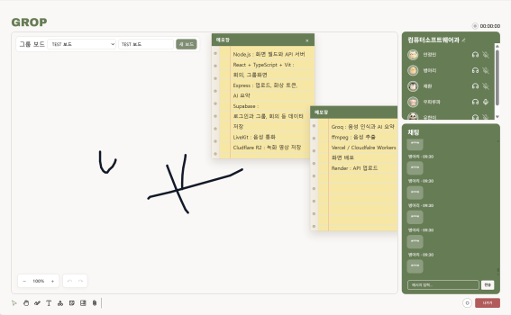 |
| **AI 요약 목록** | **AI 요약 상세** |
| 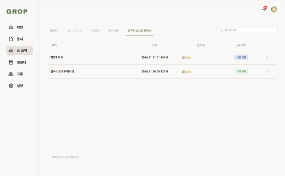 | 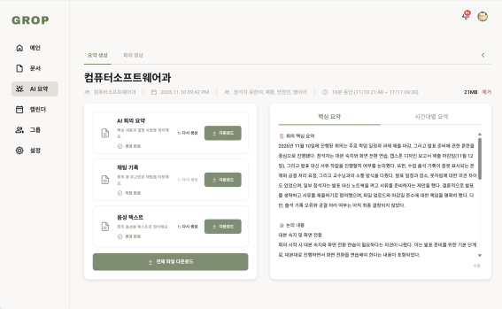 |
| **AI 요약 – 영상·타임라인** | **문서** |
| 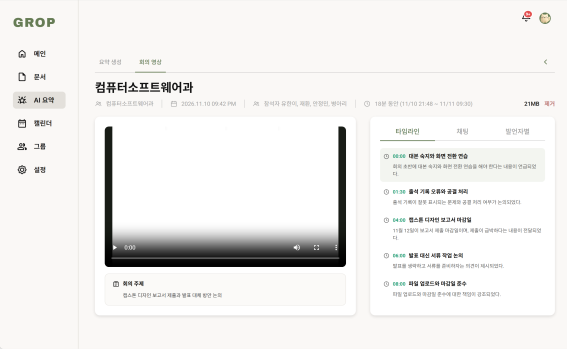 | 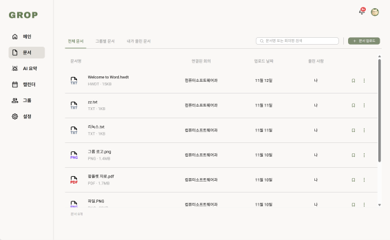 |
| **캘린더** | |
| 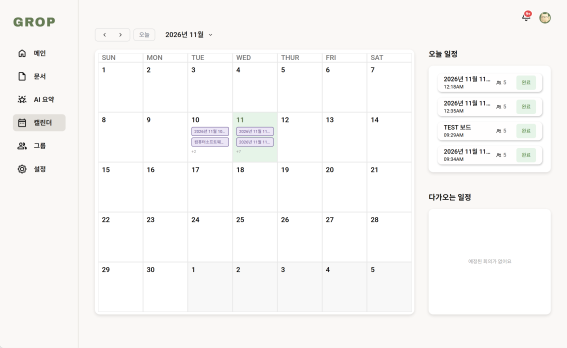 | |
