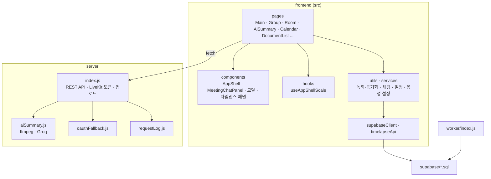

# 7단계. 수정 및 문서화

[← 문서 목차](README.md)

## 7.1 운영 메모 (운영자 매뉴얼 요약)

| 항목 | 내용 |
|---|---|
| 로컬 실행 | `npm install` 후 `npm start` (Vite 개발 서버 + Express 서버 동시 실행). 서버만 실행할 때는 `npm run server` |
| 환경변수 | Supabase URL·키, LiveKit API 키·시크릿, Groq API 키, R2 접근 키는 서버 환경변수에만 둡니다. `.env`는 저장소에 올리지 않습니다 |
| AI 모델 교체 | 모델이 폐기되어 404가 나면 코드를 고치지 말고 `GROQ_MODEL`(요약), `GROQ_TRANSCRIBE_MODEL`(전사)만 바꿉니다 |
| DB 스키마 | `supabase/` 폴더의 SQL을 번호 순서대로 실행합니다 |
| 녹화 백업 | [백업_가이드](백업_가이드.md) 참고. `scripts/backup-r2.sh`(macOS·Linux) 또는 `backup-r2.ps1`(Windows) |
| 예전 영상 이전 | 디스크(`uploads/meeting-videos`)에 남은 영상은 `scripts/migrate-videos-to-r2.js`로 R2로 옮깁니다 |
| 접속 기록 | Supabase `server_logs` 테이블, 화면에서는 `/server-logs` |

### 장애 대응 (런북)

| 증상 | 확인할 것 | 조치 |
|---|---|---|
| AI 요약이 실패함 | 서버 로그의 Groq 응답 코드 | 404면 모델명 환경변수 교체, 용량 초과면 회의를 나눠 녹화하도록 안내 |
| 회의방에 입장이 안 됨 | `/api/livekit-token` 응답, LiveKit 키 | 서버 환경변수의 LiveKit 키·URL 확인 |
| 녹화 재생이 안 됨 | `meetings.video_key` 값, 짧은 주소 만료 여부 | 주소를 다시 발급(페이지 새로고침), R2 객체 존재 확인 |
| 보드가 비어 보임 | `board_events`의 해당 보드 이벤트 | 새로고침으로 이벤트 재생 복구 |

## 7.2 한계와 개선 백로그

### 가. 데이터베이스 설계(정규화)

| 번호 | 현재 한계 | 개선 방향 |
|:--:|---|---|
| DB-1 | 리더가 컬럼이 아닌 규칙으로 표현됨. 화면은 가입 순서로, RLS는 `groups.created_by`로 판정해 기준이 어긋날 수 있음 | `group_members`에 역할 컬럼을 추가하고 기준을 하나로 통일 |
| DB-2 | `profiles`와 `group_profiles`에 닉네임·아바타가 중복되고, 이모지와 사진의 우선순위를 코드가 처리 | 공통값과 그룹별 재정의 값을 구분해 중복 컬럼 축소 |
| DB-3 | 결정 사항과 할 일이 요약 JSON 안에 있어 "내 할 일 모아보기"나 결정 이력 검색 불가 | `meeting_id` 외래키를 갖는 별도 테이블(담당자·기한·상태)로 분리 |
| DB-4 | 첨부 정보(JSONB)와 실제 파일이 한 트랜잭션으로 묶이지 않아 불일치 가능 | 경로·크기·해시를 갖는 파일 테이블로 정리 |
| DB-5 | 개인 보드와 그룹 보드가 한 테이블에 섞여 있고, 캘린더 일정은 브라우저에만 저장 | 일정 테이블 추가, 보드 종류 구분 |
| DB-6 | `board_events`가 계속 쌓임 | 오래된 이벤트의 보관·압축 정책 |

### 나. 보안

| 번호 | 현재 한계 | 개선 방향 |
|:--:|---|---|
| SEC-1 | Express의 CORS가 모든 출처를 허용 (인증은 Authorization 헤더라 즉시 위험은 작음) | 허용 출처를 서비스 주소로 제한 |
| SEC-2 | 일부 조회용 엔드포인트의 로그인·그룹 범위 확인이 일관되지 않음 | 모든 API에 동일한 인증 미들웨어 적용 |
| SEC-3 | 영상·첨부 짧은 주소가 발급 후 4시간 유효해, 그 사이 그룹에서 제외돼도 열림 | 유효 시간 단축 또는 열람 시 멤버 재확인 |
| SEC-4 | 초대 코드가 5자리이고 `Math.random`으로 생성되며 만료·시도 제한이 없음 | 암호학적 난수와 더 긴 코드, 만료·시도 제한 |
| SEC-5 | 업로드 파일의 무결성 해시를 저장하지 않음 | 업로드 시 SHA-256을 저장하고 다운로드 때 대조 |
| SEC-6 | 계정 보안이 Supabase 기본 설정에 의존 | 비밀번호 정책, 2단계 인증, 로그인 시도 제한 |

### 다. 기능 (P2 후보)

- 카메라 화상과 일반 화면 공유
- 발언자별 전사, 실시간 자막
- 알림 패널의 DB 연결 (현재 화면만 구현)
- 태그·키워드 기반 회의 검색, 채팅 기록 검색
- 외부 공유, 고급 문서 편집

## 7.3 최종 산출물

| 산출물 | 내용 | 위치 |
|---|---|---|
| 웹 애플리케이션 소스 | 프론트엔드(`src`), Express 서버(`server`), Worker(`worker`), DB 스키마(`supabase`) | 이 저장소 |
| 프로젝트 문서 | 7단계 산출물 문서 (이 폴더) | `docs/` |
| 작품 완료 보고서 | 설계서·구현 결과 포함 (캡스톤디자인 제출본) | 학교 제출 |
| 시연·발표 자료 | 최종 발표와 시연 자료 | 학교 제출 |

## 7.4 기대효과 달성도

| 계획서 목표 | 구현으로 달성한 부분 | 남은 과제 |
|---|---|---|
| 서기 없이 모든 팀원이 회의에 집중 | 녹화 → 자동 전사·요약으로 회의 중 기록 부담 제거 | 실제 팀 회의 적용 후 만족도 측정 |
| 회의록의 정확성·완성도 | 타임스탬프 기반 요약·챕터, 사람이 고칠 수 있는 초안 | 요약 품질 정량 평가 |
| 지식 자산 아카이빙 | 회의록·첨부·보드 이벤트를 DB에 저장, 문서·AI 요약 화면에서 열람·검색 | 태그·키워드 검색, 채팅 기록 저장 |
| 신규 인력 온보딩 단축 | 날짜별 회의록, 타임스탬프 이동, 타임랩스로 논의 과정 재확인 | 온보딩 시간 전후 비교 |

## 7.5 모듈 구성 (Package)

